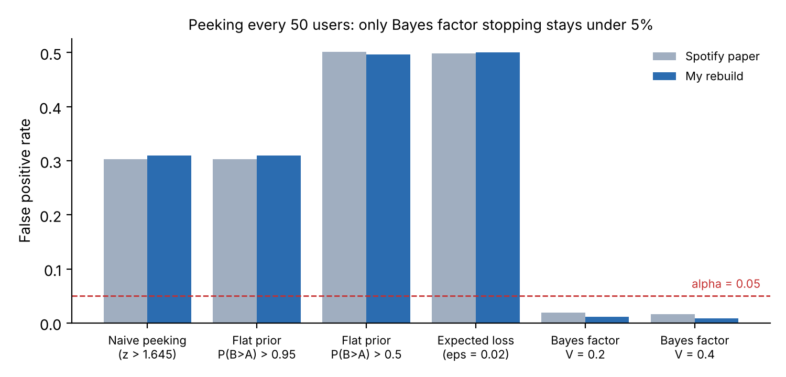
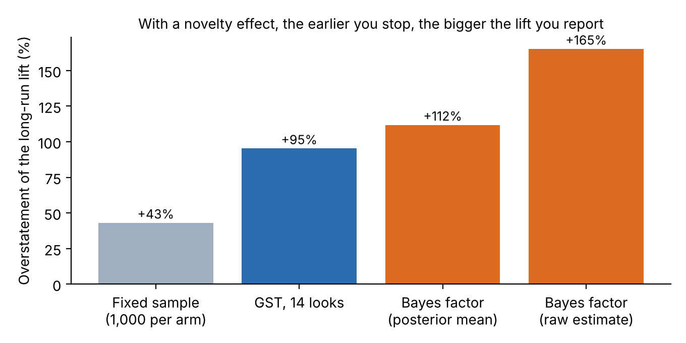

# Spotify's case against Bayesian A/B testing, rebuilt and tested on real data

An independent rebuild of Frånberg and Schultzberg (Spotify, 2026), [Why Spotify is not using Bayesian A/B testing](https://engineering.atspotify.com/2026/9/why-spotify-is-not-using-bayesian-a-b-testing/) ([arXiv 2608.12949](https://arxiv.org/abs/2608.12949)).

The hypotheses and pass/fail rules were committed before any simulation ran. See [PREREGISTRATION.md](PREREGISTRATION.md) and the first commit.

Part 1 reproduces the paper's Settings A, B and C. Part 2 is mine: a skewed real metric (MovieLens ratings per user) with the variance estimated on the fly, a novelty effect, and the winner's curse with a right and a wrong prior.

## Results against the pre-registration

| | Hypothesis | Result | Verdict |
|---|---|---|---|
| H1 | Setting A FPRs within 0.015 of the paper | Flat prior 0.310 (paper 0.303), expected loss 0.501 (0.499), BF 0.011 and 0.008 (0.019, 0.016) | Pass |
| H2 | GST power > oracle-EB BF power; oracle EB lowest MSE; pooled EB MSE > GST | 0.996 vs 0.901; 2.58 lowest; 10.11 > 6.01 | Pass |
| H3 | Winner-selected corpus FPR 0.10 to 0.30 at every size, not falling | 0.187 to 0.200 from 10 to 500 experiments | Pass |
| H4 | BF stopping keeps FPR <= 5% on the real skewed metric | 0.77% (95% CI 0.61% to 0.96%) | Pass (I expected a fail) |
| H5 | With novelty, BF overstates the long-run lift more than GST | +112% vs +95% (difference CI 15 to 19 points) | Pass |
| H6 | Calibrated EB beats the MLE on bias; pooled EB has higher error than GST | bias 0.0003 vs 0.073; MAE 0.104 vs 0.078 | Pass |

One discrepancy worth knowing: my directional BF false positive rates are about half the paper's. Counting a crossing in either direction gives 0.021 and 0.017, close to their 0.019 and 0.016.




## Files

- `spotify_bayes_replication.ipynb`: the full analysis, executed, about one minute on a laptop CPU.
- `spotify.py`: the same code as a script (percent format).
- `figures/results.json`: every number quoted above.

## Run it

```
pip install numpy pandas scipy matplotlib pyarrow
jupyter nbconvert --to notebook --execute spotify_bayes_replication.ipynb
```

The notebook downloads the MovieLens ratings from Hugging Face (`ashraq/movielens_ratings`) if `ratings.parquet` is not present.

## Credit

All ideas belong to Mattias Frånberg and Mårten Schultzberg at Spotify. This is an independent rebuild for learning. Any mistakes are mine.
