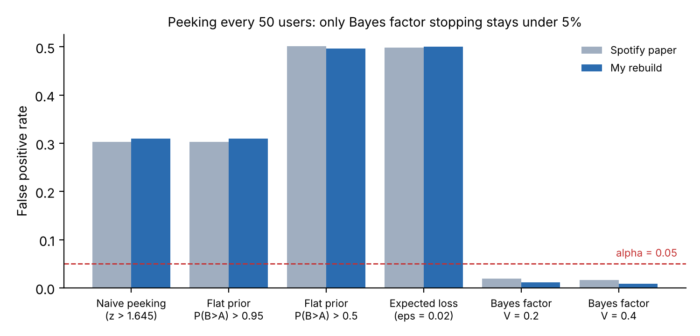
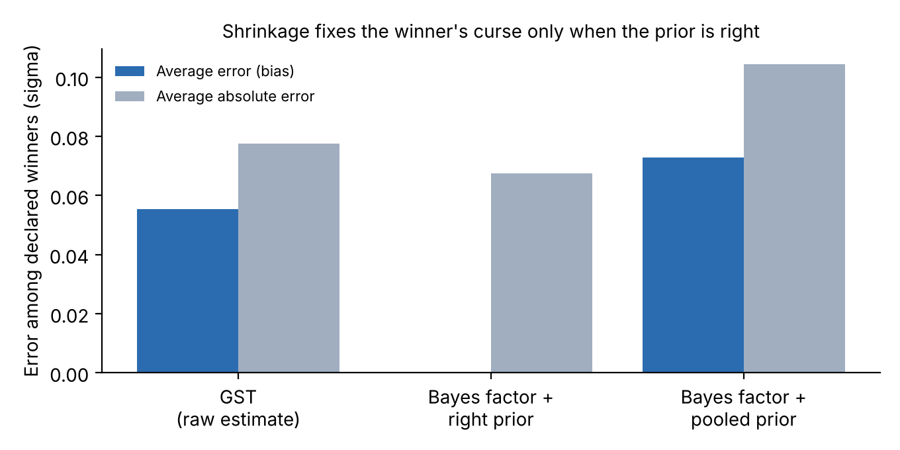

# Bayesian A/B tests still have a peeking problem. I checked Spotify's math, then tried it on real data.

## I wrote down what I expected before running anything. One of my guesses was wrong.

*Part of Big Tech measurement, rebuilt.*

Every few months someone on a product team asks why we don't just switch to Bayesian A/B testing. The pitch is always the same. You can look at the results whenever you want, the numbers are easier to explain, and you no longer have to worry about peeking. Most experimentation platforms now offer a Bayesian mode, so the question is a fair one.

In September, two data scientists at Spotify, Mattias Frånberg and Mårten Schultzberg, published [a careful answer](https://engineering.atspotify.com/2026/9/why-spotify-is-not-using-bayesian-a-b-testing/) along with [a paper](https://arxiv.org/abs/2608.12949). Their argument is that "Bayesian A/B testing" is not one method. It is a choice of prior plus a choice of when to stop, and the most common default, a flat prior where you ship once the probability that B beats A passes 95%, behaves exactly like a frequentist who peeks every day. The configurations that do protect you, like stopping on a Bayes factor, exist, but they give you about the same guarantees as the group sequential tests Spotify already uses.

I wanted to know two things. Do their numbers hold up if someone else writes the code? And do they still hold when the data looks like a real product metric instead of a textbook normal distribution?

## How I set it up

Before running anything, I wrote down every hypothesis with a pass or fail rule and committed it to git, so the timestamp shows the predictions came first. Part one rebuilds their simulations with the settings from their appendix. Part two is mine. It uses a real metric, ratings per user from MovieLens, which is about as skewed as engagement data gets: the median user has 7, the mean is 20, and one user has 6,614. Each simulated experiment splits real users into two groups, so the outcomes are real, but the experiments are simulated.

## Part one: their numbers came back

Under the null, with a look every 50 users, a flat prior that stops at 95% declared a false winner 31.0% of the time. They report 30.3%. Expected-loss stopping, a rule some platforms ship, came out at 50.1% against their 49.9%. The group sequential test held its 5%, and the Bayes factor rules stayed far below it.

The one number that didn't match at first was the Bayes factor rate. I got 1.1% where they report 1.9%. I spent some time on this before noticing that if I count a crossing in either direction instead of only "B wins", I get 2.1%, much closer to their figure. My guess is that their table counts both directions, although the text describes a one-direction decision. It doesn't change the conclusion, but it is the kind of detail you only find by rebuilding.

The comparison with group sequential testing also matched. With 14 looks, GST had 99.6% power against 90.1% for Bayes factor stopping with a perfect prior, and its error on the effect estimate was 6.0 (times 1,000) against their 5.9. The perfect empirical Bayes prior had the lowest error of everything, 2.6 against their 2.7, and a prior fitted on a corpus that mixes two programs had the highest, 10.1 against their 10.4. Their warning about corpora that only keep past winners also came back. A prior fitted on winners produced false positives in 20% of null experiments with ten metrics, and that stayed between 19% and 20% whether the corpus had 10 experiments or 500. More data from a biased source doesn't fix the bias.

## Part two: I expected the real metric to break it. It didn't.

My first prediction was that Bayes factor stopping would lose its guarantee on a skewed metric. Their proof assumes normal data with a known variance, and a platform has to estimate the variance as data comes in, starting from 50 users per group, where one heavy user can swing everything. I was wrong. Across 10,000 A/A tests on the real metric, Bayes factor stopping declared a false winner 0.77% of the time, and the group sequential test 4.7%. Naive peeking was as bad as ever at 30.8%. When both groups come from the same skewed population, the heavy users land on both sides and the test mostly copes.

## Where it does go wrong: novelty

The second extension was a novelty effect, which every product team has seen. I set the true long-run lift at 0.1 standard deviations, starting at twice that and fading with a half-life of a third of the test. Nothing in the paper covers this, because their effects are constant.

Even a fixed-length test overstated the long-run lift by 43%. That is simply the average effect during the test, which included the honeymoon. Stopping early made it worse. Among the tests that declared a winner, group sequential testing overstated the lift by 95%, and Bayes factor stopping by 112%, even after its prior pulled the estimate toward zero. Its raw estimate at the moment it stopped was 165% too high. The Bayes factor test also missed more, detecting the change in 73% of runs against 94% for GST. The early stoppers catch the experiments where the first days looked great, which in this case are exactly the days that don't last.

## The winner's curse, with a right and a wrong prior

The last test was on the claim Spotify calls the least problematic: that shrinkage fixes the winner's curse. In a program where 30% of experiments have a real effect, group sequential testing declared 696 winners, 173 of them false, with estimates 0.055 standard deviations too high on average. Bayes factor stopping with the correct prior declared fewer winners, 398 with 19 false, and its reported estimates were almost exactly unbiased. The same stopping rule with a prior from pooled programs was off by 0.073, and its average absolute error, 0.104, was worse than GST's 0.078. So the claim holds, but only when the prior is right, and you rarely know that it is.

## What I take from it

The useful part of Spotify's paper isn't "frequentist good, Bayesian bad". It is that the stopping rule matters more than the philosophy. A flat-prior Bayesian dashboard that people check every morning has the same 31% false positive rate as a p-value people check every morning. If a team wants the Bayesian vocabulary, it should come with Bayes factor stopping, and the prior should come from a corpus someone actually maintains.

The part I'd add is about time. Every method I tested reports the effect during the test, and products change during tests. If a feature looks like it has a novelty effect, the fix isn't a better statistic. It's running long enough to see the effect settle, or comparing the first and last weeks before calling it.

---

*Notebook and code: [github.com/ZFayFay/spotify-bayes-replication](https://github.com/ZFayFay/spotify-bayes-replication). The pre-registration is the first commit. All ideas belong to Mattias Frånberg and Mårten Schultzberg at Spotify. This is an independent rebuild of their [post](https://engineering.atspotify.com/2026/9/why-spotify-is-not-using-bayesian-a-b-testing/) and [paper](https://arxiv.org/abs/2608.12949).*
