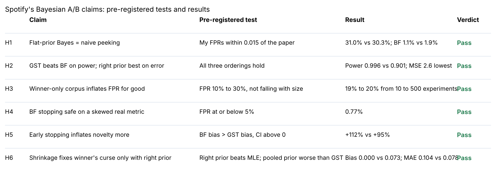
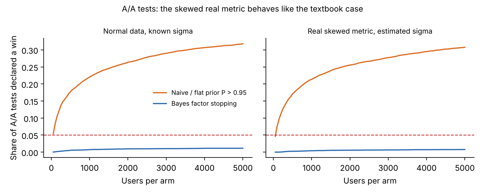
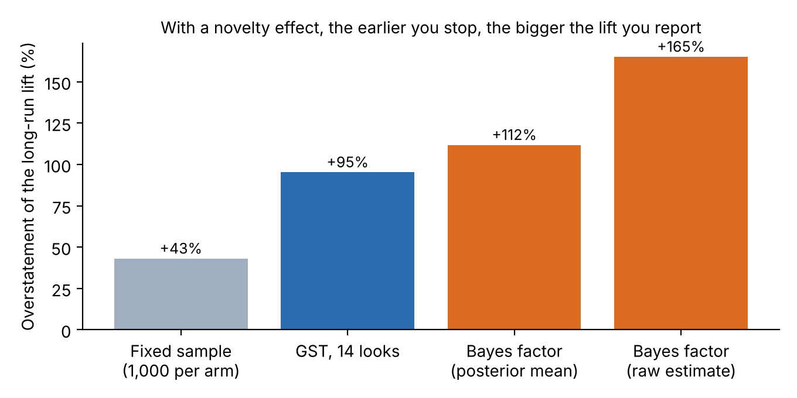

# Bayesian A/B tests still have a peeking problem. I checked Spotify's math, then tried it on real data.

## I wrote down six predictions before running anything. All six held, including the one I expected to fail.

*Part 2 of Big Tech measurement, rebuilt.*

Every few months someone on a product team asks why we don't just switch to Bayesian A/B testing. The pitch is always the same: you can look at results whenever you like, the numbers are easier to explain, and peeking stops being a problem. Most experimentation platforms now ship a Bayesian mode, so it's a fair question, and the usual answers on both sides are more conviction than evidence.

In September, two data scientists at Spotify, Mattias Frånberg and Mårten Schultzberg, published [a careful answer](https://engineering.atspotify.com/2026/9/why-spotify-is-not-using-bayesian-a-b-testing/) with [a paper](https://arxiv.org/abs/2608.12949) behind it. This post is my attempt to check it independently, and then to push it somewhere the paper doesn't go.

## What Spotify argues

Their main point is that "Bayesian A/B testing" isn't one method. It is a prior plus a rule for when to stop, and the guarantees depend almost entirely on that pair. The most common default is a flat prior where you ship once the probability that B beats A passes 95%. Under a flat prior that probability is just one minus the p-value, so checking it every day is exactly the same as checking a p-value every day, with the same inflated false positives. The configurations that really are safe to monitor continuously stop on a Bayes factor, a ratio of how well "there is an effect" explains the data compared with "there is none". The math guarantees that a Bayes factor threshold of 20 keeps false positives under 5%, however often you look. But Spotify shows those configurations end up close to the group sequential tests (GST) they already use, which set stricter thresholds for early looks. The one real Bayesian advantage they find is shrinkage: with a prior fitted on many past experiments, estimates are pulled toward realistic sizes, which tames the winner's curse. That only works if the prior is right.

## How I tested it

Before writing any code, I listed six hypotheses with a pass or fail rule for each and committed them to git, so the date shows they came before the results. The first three reproduce the paper's own simulations from the settings in its appendix: normal data, an effect of 0.2 standard deviations when there is one, and 5,000 to 10,000 simulated experiments per configuration. The last three are mine. They ask what happens when the data looks like a real product metric, and when the effect changes during the test.

For the real metric I used ratings per user in MovieLens, which is about as skewed as engagement data gets. The median user has 7, the mean is 20, and one user has 6,614. Each simulated experiment splits real users into two groups at random, so the outcomes are real even though the experiments are simulated.

*Figure 1. The six pre-registered hypotheses, the rule each had to meet, and what happened.*

## Their numbers came back, with one small puzzle

With a look every 50 users and no real difference between the groups, the flat prior with a 95% threshold declared a false winner in 31.0% of experiments. Spotify reports 30.3%, and with 10,000 runs my number is accurate to within about one point. Expected-loss stopping, a rule some platforms ship that stops once the expected cost of a wrong choice is small, came out at 50.1% against their 49.9%. The group sequential test held its 5%, and the Bayes factor rules stayed well below it.

*Figure 2. False positive rate when you check after every 50 users, for six stopping rules. Grey is Spotify's paper, blue is my rebuild.*

The one number that didn't match was the Bayes factor rate: 1.1% where they report 1.9%. I spent a while on it before trying the obvious thing. If I count a crossing in either direction, rather than only "B wins", I get 2.1%, close to their figure. Their text describes a one-direction decision, so I think the table counts both. It doesn't change any conclusion, but it is the kind of detail you only find by rebuilding.

The comparison with group sequential testing matched closely. With 14 looks, GST detected the effect 99.6% of the time against 90.1% for Bayes factor stopping with a perfect prior. The perfect empirical Bayes prior had the smallest estimation error of everything, 2.6 (times 1,000) against their 2.7, and a prior fitted on a corpus that mixes two different programs had the largest, 10.1 against 10.4. Their warning about corpora that keep only past winners also came back. A prior fitted on winners gave false positives in 20% of null experiments with ten metrics, and that stayed between 19% and 20% whether the corpus held 10 experiments or 500. More data from a biased source doesn't remove the bias.

## I expected the real metric to break it. It didn't.

My own prediction was that Bayes factor stopping would lose its guarantee on a skewed metric. The proof assumes normal data with a known variance. A platform has to estimate the variance as data arrives, starting at 50 users per group, where one heavy user can move everything. I was wrong. Over 10,000 A/A tests on the real metric, Bayes factor stopping declared a false winner 0.77% of the time and GST 4.7%. Naive peeking was as bad as ever at 30.8%. When both groups are drawn from the same skewed population, the heavy users land on both sides, and the test copes.

*Figure 3. Share of A/A tests declared a winner by each point in the test. Left: textbook normal data. Right: the skewed real metric with the variance estimated as data comes in.*

## Where it does go wrong: novelty

Spotify's simulations hold the effect constant. Real features often have a honeymoon. In my next test the true long-run lift is 0.1 standard deviations, starting at twice that and fading with a half-life of a third of the test.

Even a fixed-length test overstated the long-run lift by 43%. That isn't a statistical failure, it's the average effect over a period that included the honeymoon. Stopping early made it worse. Among the experiments that declared a winner, GST overstated the long-run lift by 95%, and Bayes factor stopping by 112%, even after its prior pulled the estimate toward zero. Its raw estimate at the moment it stopped was 165% too high. The difference between the two methods is clear, with a bootstrap interval of 15 to 19 points. The Bayes factor test also detected the change less often, 73% of the time against 94% for GST. Early stoppers catch the experiments where the first days looked great, and here the first days are the part that doesn't last.

*Figure 4. How much each method overstates the long-run lift when the effect starts at twice its final size and fades.*

## The winner's curse, with a right and a wrong prior

The last test was on the claim Spotify calls the least problematic: that shrinkage fixes the winner's curse. In a program where 30% of experiments have a real effect, GST declared 696 winners, 173 of them false, and the estimates for its winners were 0.055 standard deviations too high on average. Bayes factor stopping with the correct prior declared 398 winners with 19 false, and its estimates were almost exactly unbiased, while the raw estimate at the same stopping points was 0.073 too high. The same rule with a prior fitted on pooled programs was 0.073 too high after shrinkage, and its average absolute error, 0.104, was worse than GST's 0.078. The claim holds, but only when the prior is right.

*Figure 5. Error of the reported effect among experiments declared winners, under three methods.*

## Limits of this rebuild

Part one uses Spotify's own simulation settings, so it checks their arithmetic rather than their assumptions. Part two uses one real metric and one shape of novelty effect. The real metric is resampled users, so it captures skew but not trends over calendar time. I didn't test multiple metrics on real data or decision-theoretic costs.

## What I take from it

The useful part of Spotify's paper isn't "frequentist good, Bayesian bad". It's that the stopping rule matters more than the philosophy. A flat-prior Bayesian dashboard that people check every morning has the same 31% false positive rate as a p-value people check every morning. If a team wants the Bayesian vocabulary, it should come with Bayes factor stopping, and any informative prior should come from a corpus someone maintains and audits for winner bias.

The part I'd add is about time. Every method I tested reports the average effect during the test, and products change during tests. If a feature might have a novelty effect, the answer isn't a cleverer statistic. It's running long enough to see the effect settle, or comparing the first and last weeks before deciding.

---

*Notebook and code: [github.com/ZFayFay/spotify-bayes-replication](https://github.com/ZFayFay/spotify-bayes-replication). The pre-registration is the first commit. All ideas belong to Mattias Frånberg and Mårten Schultzberg at Spotify. This is an independent rebuild of their [post](https://engineering.atspotify.com/2026/9/why-spotify-is-not-using-bayesian-a-b-testing/) and [paper](https://arxiv.org/abs/2608.12949). Any mistakes are mine.*
